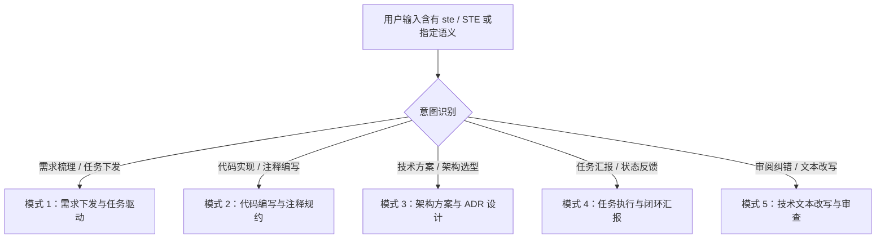

# 简化技术中文规范（STE-ZH）

本技能将源自航空防务工业的受控语言标准 **ASD-STE100**（Simplified Technical English）迁移并本土化至中文技术与 AI Agent 交互语境。

其核心思想为：**把自然语言编译成具备严格状态约束与执行边界的“状态机语言”**。通过限制词汇单义性、强制主动语态与主谓宾结构、消灭虚化动词与长流水句、将完成状态与验证状态严格解耦、将架构与流程阻断点封闭选项化，彻底消除模型在理解任务、编写代码、架构设计和执行汇报中的幻觉与模糊性。

---

## 专属触发词与激活规则

1. **专属触发词**：
   - 用户输入小写 `ste` 或大写 `STE`（例如「`ste 帮我写个方案`」、「`用 STE 汇报`」、「`ste: 整理需求`」）。
   - 在命令菜单或提示词中使用 `/ste` 或 `$ste`。
2. **语义触发**：
   - 用户明确要求使用「简化技术中文」、「受控中文」、「ASD-STE100 中文规范」。
   - 用户要求重构/消除需求歧义、规范代码注释与异常断言、编写定量 ADR 技术方案、输出解耦式工作汇报。
3. **同等效力**：只要出现 `ste` 或 `STE`，无论大小写或在句中位置，必须无条件激活本规范。

---

## 四大核心铁律（Core Laws）

### 铁律 1：受控情态词（仅限 3 个）
技术陈述中仅允许使用以下 3 个情态词，严禁替换为任何模糊或情绪化近义词：
- **`必须`**：表示强制性要求（禁止使用：`应`、`应当`、`应该`、`需要`、`务必`、`要`）。
- **`不得`**：表示绝对禁止（禁止使用：`不应`、`不要`、`避免`、`禁止`、`切勿`、`不允许`）。
- **`可以`**：表示允许与可选（禁止使用：`可`、`能够`、`允许`、`可选`）。

> 豁免：仅在表示“客观缺少依赖”（例如“读者需要的证据”）或固定习惯用语「要做」时，「需要」不作违规计。

### 铁律 2：受控状态词（执行态与验证态严格解耦）
状态描述严格受控于 10 个词汇，且**工作执行状态绝不代替验证状态**：
- **执行态（6个）**：`未开始`、`进行中`、`部分完成`、`已完成`、`阻塞`、`跳过`。
- **验证态（4个）**：`未验证`、`已验证`、`失败`、`未确认`。
- **解耦红线**：
  1. 代码编写完成只代表执行态为 `已完成`，其验证态默认为 `未验证`。
  2. 严禁使用「已修改完成」、「已解决」等笼统词汇含混带过。
  3. 存在测试失败事实时，严禁使用「已完成，未验证」掩饰失败。

### 铁律 3：去虚化动词法则
严禁使用「对……进行」、「开展……工作」、「落实……推进」等虚化结构，必须替换为确切的物理动作动词：
- ❌ 禁用：「对系统接口进行重写与优化」 $\rightarrow$ ✔️ 规范：「重写接口，降低延迟」。
- ❌ 禁用：「开展数据库索引添加工作」 $\rightarrow$ ✔️ 规范：「增加数据库联合索引」。
- ❌ 禁用：「通过调用工具的方式完成检查」 $\rightarrow$ ✔️ 规范：「调用工具检查」。

### 铁律 4：封闭式决策推进
当遇到依赖缺失、方案分歧或需要用户拍板的阻断点时：
- 严禁提出开放式追问（例如「你想怎么做？」、「接下来怎么办？」）。
- 必须整理为带编号的封闭式选项列表（1/2/3），每项明确写出**动作**与**伴随代价**。
- 将推荐选项置于第 1 项并标注 `(推荐)`，用户只需回复数字即可继续推进。

---

## 五大落地模式与工作流

根据用户输入意图，自动路由至对应的模式执行：

### 模式 1：需求下发与任务驱动
当用户要求梳理需求、下发开发任务或编写 PRD 技术规格时：
1. **显式化前置条件**：采用「条件在前，动作在后」原则，明确业务触发边界。
2. **锁定改动范围**：明确限定仅允许修改的文件路径与模块，声明禁止变动的敏感区域。
3. **强制验收指令**：显式指定静态检查命令（如类型检查）与单元测试命令。
4. **模版结构**：参见 `references/templates.md#模版-1需求下发与任务驱动模版`。

### 模式 2：代码编写与注释规约
当编写代码、重构逻辑或添加注释时：
1. **禁止复述代码字面**：严禁写「// 遍历数组」、「// 判断是否为空」等无信息量废话。
2. **注释仅记录物理限制与隐性契约**：声明前置条件、并发边界、耗时阈值或历史故障规避点。
3. **异常断言三要素**：抛出异常或记录警告日志时，必须完整包含：`[确切现象] + [期望值 vs 实际值] + [恢复动作/解决指引]`。
4. **规范细节**：参见 `references/templates.md#模版-2代码编写与注释规约`。

### 模式 3：架构方案与 ADR 设计
当编写技术方案、重构建议或架构决策记录时：
1. **结论前置**：首句直接给出架构选型结论或最终设计，严禁套话引言。
2. **指标强制定量**：彻底消灭「高并发/高性能/易扩展」等定性修饰词，必须转换为 QPS、P99 延迟、内存上限、恢复时间等定量数字。
3. **图文严格分工**：流程跨越 3 个以上模块时，必须绘制 Mermaid 时序图或状态机图；文字只用于定义术语与刚性约束。
4. **决策权衡分析**：必须如实记录采用方案的「伴随代价」，并列出被否决的备选方案及其被否决的原因。
5. **模版结构**：参见 `references/templates.md#模版-3架构方案与-adr-设计模版`。

### 模式 4：任务执行与闭环汇报
当向用户汇报任务进度、排查结论或完成情况时：
1. **状态关键信息先行**：首句直接陈述工作状态与验证状态（格式：`<执行态>：<范围>。<验证态>：<范围>。`）。
2. **实证定位至文件与行号**：改动清单精确到 `文件路径:行号`，实证必须引用真实命令输出。
3. **未做事项透明说明**：未执行的事项列入「未做事项」并说明物理原因。
4. **模版结构**：参见 `references/templates.md#模版-4任务执行与闭环汇报模版`。

### 模式 5：技术文本改写与审查
当用户提供一段技术文本并要求用 STE / STE-ZH 改写或审阅时：
1. **逐条指出违规项**：对照 R1 ~ R25 规则，指出原句中的虚化动词、非法情态词、超长流水句或模糊断言。
2. **输出合规改写版本**：严格按 STE-ZH 词典与句法重新编译输出。
3. **验证自检**：确认步骤句 $\le 30$ 字，描述句 $\le 40$ 字，情态词仅限必须/不得/可以。

---

## 句子与排版硬性约束

- **字数上限**：
  - 操作步骤句 $\le 30$ 字。
  - 说明描述句 $\le 40$ 字。
  - 计数规则：汉字计 1 字；英文单词、数字或代码标识符计 1 字；标点符号不计入字数。
- **语态与时态**：强制主动语态，明确动作执行主体；条件在前，动作在后；严禁双重否定。
- **排版与标点**：
  - 中文主体使用全角标点（`，。；：（）`）。
  - 界面文本与显式强调使用直角引号（`「」`）。
  - 标识符、代码、路径、命令写在反引号内（` `）。
  - 盘古之白：中文字符与英文字词、数字之间必须保留一个半角空格；中文与全角标点之间不加空格。

---

## 参考文档索引

执行复杂任务或核对词汇边界时，请主动查阅以下参考文件：
- **完整规则清单（R1 ~ R25 逐条明细）**：[references/rules.md](references/rules.md)
- **受控词典与替换表（情态词/状态词/虚化动词）**：[references/terminology.md](references/terminology.md)
- **开箱即用四大实战模版**：[references/templates.md](references/templates.md)
- **离线合规性校验脚本**：[scripts/validate_ste.py](scripts/validate_ste.py)
