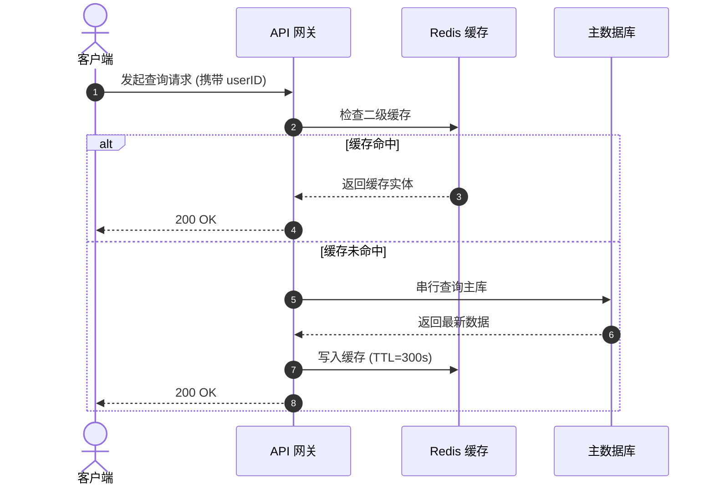

# STE-ZH 实战模板集合（Templates）

本文档提供四大场景的开箱即用模板与示范，涵盖需求下发、代码注释、架构方案设计与闭环工作汇报。

---

## 模版 1：需求下发与任务驱动模版
适用场景：技术主管给开发人员下发任务，或用户驱动 AI Agent 编写/修改代码。

```markdown
请按【STE-ZH 简化技术中文】规范执行以下开发任务：

## 1. 任务目标
[动作：增加/重构/修复] [确切组件/接口名称]，消除 [具体的物理故障现象或满足确切指标]。

## 2. 约束边界
- 业务前置条件：当且仅当 [条件 A] 满足时，允许执行 [动作 B]。
- 范围约束：仅允许修改 [具体文件路径]，不得修改公共配置文件与数据库持久化结构。
- 逆向保护：遇到 [异常条件] 时，必须抛出 [确切异常]，不得吞没异常，不得返回 null。

## 3. 验收验证标准
必须执行以下验证命令，并附带执行结果：
1. 单元测试：执行 `[测试命令]`，必须覆盖 [具体边缘用例]。
2. 静态检查：执行 `[类型检查命令]`（PHPStan Level 5+ / TypeScript strict 等）。
3. 状态声明：改动完成后，分别声明【执行状态】与【验证状态】。
```

### 示范样例
```markdown
请按【STE-ZH 简化技术中文】规范执行以下开发任务：

## 1. 任务目标
重构 `PaymentService::processRefund` 接口，消除重复扣减余额的并发风险。

## 2. 约束边界
- 业务前置条件：退款金额必须大于 0 且不超过原订单实付金额。
- 范围约束：仅允许修改 `src/Services/PaymentService.php`，不得修改 `orders` 表结构。
- 逆向保护：退款请求已被消费时，必须抛出 `DuplicateRefundException`，不得重复入账。

## 3. 验收验证标准
必须执行以下验证命令，并附带执行结果：
1. 单元测试：执行 `vendor/bin/phpunit --filter PaymentServiceTest`，测试必须包含并发退款用例。
2. 静态检查：执行 `vendor/bin/phpstan analyse -l 8 src/Services/PaymentService.php`。
3. 状态声明：改动完成后，分别声明【执行状态】与【验证状态】。
```

---

## 模版 2：代码编写与注释规约模版
适用场景：团队代码规范，或指导 AI Agent 编写函数注释与日志断言。

```markdown
## 代码编写与注释规范（STE-ZH）

### 1. 注释核心原则（禁止复述代码字面）
- 不得编写复述代码逻辑字面的废话（如：`// 循环遍历用户列表`）。
- 注释仅用于声明代码无法自解释的物理限制、历史事故规避点或跨服务隐性契约。
- 包含触发条件时，严格遵守「条件在前，动作在后」。

### 2. 函数注释示范
```typescript
/**
 * 扣减账户可用余额并记录交易日志。
 *
 * 约束：
 * - 余额不足时，不得扣减余额，必须抛出 InsufficientBalanceException。
 * - 单笔扣减耗时必须小于 200ms。重试 3 次仍超时，回滚本地事务。
 * - 事务未提交前，不得调用第三方外部支付通知网关。
 */
public async deductBalance(userId: string, amount: number): Promise<TransactionReceipt> {
    // ...
}
```

### 3. 异常与日志断言规范（警告与异常必须携带可恢复动作）
抛出异常或记录 Error/Warning 日志时，必须完整包含三要素：
`[实际现象] + [期望值 vs 实际值] + [恢复动作指引]`。

```typescript
// ❌ 错误示范：裸错误信息，无上下文无恢复指引
throw new Error("Invalid timeout value");

// ✔️ 规范示范：现象清晰、边界量化、指明解决步骤
throw new InvalidArgumentException(
    "连接池超时配置无效。期望值为 100~5000ms，当前输入为 " + timeout + "ms。请检查 config/database.json 中的 pool.timeout 配置项。"
);
```
```

---

## 模版 3：架构方案与 ADR 设计模版
适用场景：编写架构决策记录（ADR）、重构技术方案或系统设计评审。

```markdown
# [方案标题：动作 + 系统/模块 + 解决问题]

## 1. 决策结论（结论前置）
[首句直接给出架构选型结论、核心方案或改造手段，严禁套话引言]。

## 2. 现状与定量指标差距
| 维度 | 当前物理现状 | 方案达成目标（必须量化） | 验证指标方法 |
| :--- | :--- | :--- | :--- |
| 吞吐能力 | QPS 约为 400（瓶颈在行级互斥锁） | QPS ≥ 2500 | 压测工具 `wrk -t4 -c100` |
| 响应延迟 | P99 = 850ms | P99 ≤ 80ms | 接入 APM 链路跟踪监控 |
| 容灾指标 | 单机节点故障影响 50% 流量 | 单机故障在 3 秒内剔除，错误率 ≤ 0.01% | 混沌工程注入实验 |

## 3. 架构设计与流转过程
[跨越 3 个以上模块流转的过程，严禁连续使用 6 行以上文字说明，必须使用 Mermaid 时序图；文字只用于定义术语和约束]



## 4. 技术选型权衡（ADR 核心分析）
### 4.1 采用方案：[方案名称]
- **解决的核心矛盾**：[用一句话说明解决了什么物理瓶颈]。
- **伴随代价与负面影响**：[必须如实列举引入的系统复杂度、网络开销或运维成本]。

### 4.2 被否决的备选方案
- **否决方案 A**：[方案名称]。
  - **否决原因**：[指出其致命缺点，如侵入底层架构、不可水平扩展]。
- **否决方案 B**：[方案名称]。
  - **否决原因**：[指出其致命缺点]。

## 5. 待决决策项（选项化推进）
- **待确认事项**：[描述阻塞当前落地的决策点]
  - **选项 1 (推荐)**：[方案概述] —— 收益：[点]；代价：[点]。
  - **选项 2**：[方案概述] —— 收益：[点]；代价：[点]。
```

---

## 模版 4：任务执行与闭环汇报模版
适用场景：AI Agent 完成代码修改、Bug 排查或任务推进后向用户输出闭环汇报。

```markdown
## 任务执行与验证汇报

<工作状态词>：<明确的完成范围>。<验证状态词>：<明确的测试范围>。

### 1. 代码改动清单
* `<文件路径1>:<起始行号>`：<具体改动动作，禁用虚化词>。
* `<文件路径2>:<起始行号>`：<具体改动动作>。

### 2. 实证与验证
* **已验证**：执行 `<具体验证命令>` —— 结果：<明确指标，如：通过全部 24 项测试，覆盖并发边界>。
* **未验证**：<明确未验证的范围> —— 原因：<无外部硬件环境/需线上发布后观测>。

### 3. 未做事项（如有）
* <未处理的次要事项> —— 原因：<超出本次任务范围/需要前置依赖就绪>。

### 4. 待确认事项（需用户决策）
* 是否执行 [下一步操作]：
  1. (推荐) [动作 A] —— [理由与后果]。
  2. [动作 B] —— [理由与后果]。
```

### 示范样例
```markdown
## 任务执行与验证汇报

已完成：重构订单幂等处理逻辑。已验证：核心业务单元测试。

### 1. 代码改动清单
* `src/OrderProcessor.php:45`：增加基于 Redis 分布式锁的防重校验。
* `tests/OrderProcessorTest.php:112`：增加并发发起 10 次相同订单的单元测试用例。

### 2. 实证与验证
* **已验证**：执行 `vendor/bin/phpunit --filter OrderProcessorTest` —— 结果：12 项测试全部通过（耗时 180ms）。
* **未验证**：真实生产集群多节点网络分区测试 —— 原因：本地无法模拟机房级断网。

### 3. 未做事项
* 历史无幂等标识的老数据刷库 —— 原因：需要单独的数据迁移脚本与停机窗口。

### 4. 待确认事项
* 是否立即合并分支并触发预发环境部署：
  1. (推荐) 合并分支至 staging，由测试人员执行端到端回归验证。
  2. 暂缓合并，等待数据迁移脚本一并编写完成后统一提交。
```
