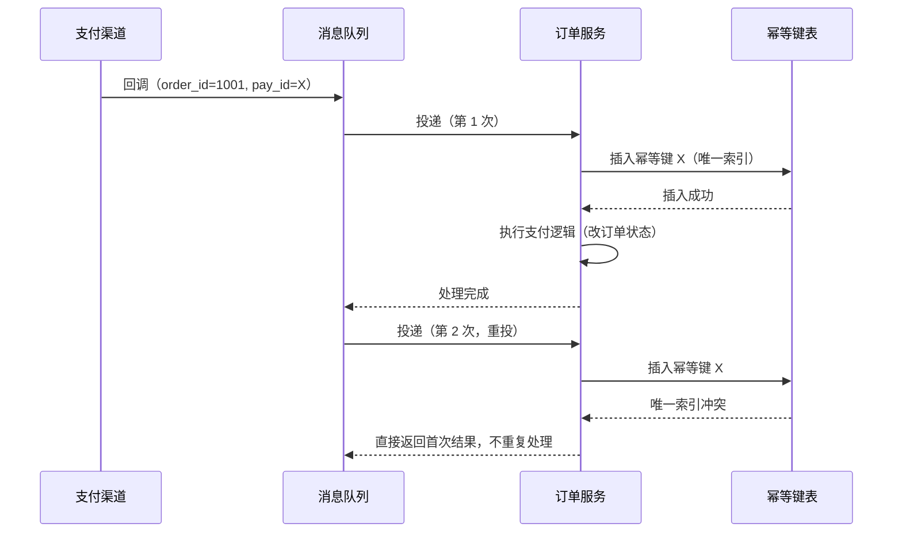

# 幂等

幂等是指同一个操作执行一次和执行多次，对系统最终状态的影响相同。

适用场景：设计接口重试策略、处理消息重复投递、排查支付回调或下单接口的重复扣款时。

成熟度（status: budding）：已用自己的话重写、可以链接；概念尚未完全定稿。

核实状态（verified: none）：本篇为流程实测示例，结论未逐一查证原始来源。

## 它解决什么问题

网络请求会超时，但请求可能已经成功。客户端拿到超时响应时，不知道该重试还是不该重试：重试可能重复扣款或重复下单，不重试可能真的漏掉这次操作。工程师需要一
种操作约定，让重复执行不再有副作用，重试才是安全的。

消息系统放大了这个问题。队列为了保证不丢消息，通常采用至少一次投递：同一条消息可能被投递两次、消费者可能处理失败后重新拿到。只要消费方处理重复投递的成本
降不下来，重试机制就不敢放开。

## 它怎么解决的

「幂等」来自数学：f(f(x)) = f(x)，即对同一输入重复施加同一变换，结果不再改变。工程上的含义与之对应：对同一资源重复提交同一请求，最终状态与
只提交一次相同。

注意区分幂等和「重复效果」：给日志系统写一条记录，写两次就是两条记录——每次执行都产生新效果，这不是幂等；把订单状态改成「已支付」，改两次和改一次状态一
样，这是幂等。

常用实现手段：

| 手段 | 做法 | 代价 |
|---|---|---|
| 唯一请求键 | 请求携带唯一标识，服务端遇到已处理的键直接返回首次结果 | 需要存储已处理的键及其结果 |
| 状态机前置检查 | 处理前先检查当前状态是否允许该操作（如订单已支付则拒绝再次支付） | 依赖明确的状态流转规则 |
| 唯一约束兜底 | 用数据库唯一索引挡住重复写入 | 需要存在唯一的业务键 |

与相邻概念的区别：原子性管「一次操作不可分割」，幂等管「多次执行等效于一次」，两者回答的是不同问题。

## 一个具体场景

支付回调重复投递。支付渠道以至少一次的方式推送支付成功回调，消息队列消费失败后会重投，同一个订单可能收到两次回调。带幂等键的时序如下：

关键在第二次投递：服务端不靠「记不记得处理过」来判断（那需要查询历史），而是让唯一索引本身挡下重复写入——插入失败即视为重复，直接返回首次结果。扣款动作
只执行一次。

## 边界与例外

- 创建类操作天然不幂等。每次 `POST /orders` 都创建新订单，重复提交就是重复订单。把创建变幂等的办法是带客户端生成的订单键，服务端以该键去重
  ——这等于把「创建」改造成「条件创建」。
- 幂等不等于操作顺序无关。两个请求谁先到谁后到，最终状态可能相同，但中间的可见状态会随顺序变化；要保证所有观察者看到一致的顺序，需要的是线性一致性，那是另
  一个问题。
- 幂等不等于安全。按 HTTP 方法的经典分类，GET 幂等且安全，PUT 和 DELETE 幂等但不安全（首次执行就改变了可观察状态），POST 两者皆非。

| HTTP 方法 | 幂等 | 安全 |
|---|---|---|
| GET | 是 | 是 |
| PUT | 是 | 否 |
| DELETE | 是 | 否 |
| POST | 否 | 否 |

- 幂等只保护「重复执行」，不保护「错误执行」：参数写错的请求重复执行多少次都是错的。

## 相关概念

- [[至少一次投递]] —— 为什么相关：至少一次投递是幂等需求的主要来源，重复投递靠消费方的幂等处理来消化。
- [[原子性]] —— 为什么相关：两者常被并列讨论，但原子性管一次操作不可分割，幂等管多次执行等效，回答的是不同问题。
- [[乐观锁]] —— 为什么相关：乐观锁用版本号解决并发写冲突，与幂等键去重是相邻的两种重复防护手段，一个管并发、一个管重试。
